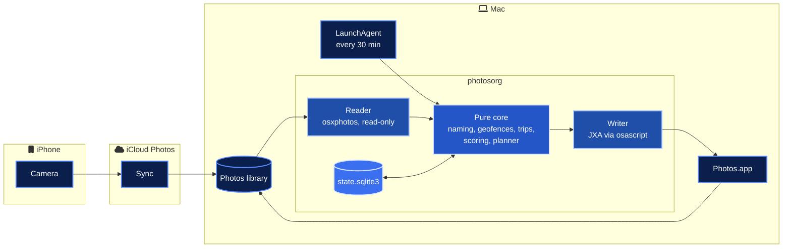
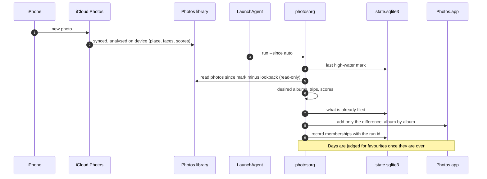
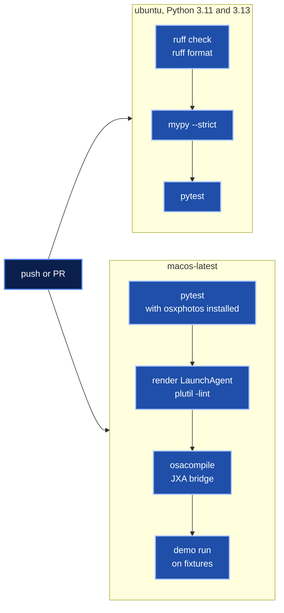

<div align="center">


# Photos Smart Organizer

Take the photo on your iPhone. By the time you open your Mac, it is already in the right albums.


<br>


</div>

## In numbers

| | |
| ---: | --- |
| 6 | album rules (country, city, geofence, year, month, trip) |
| 6 | weighted scoring signals, plus 2 penalties and 4 exclusions |
| 3 | de-duplication passes (burst, Photos duplicates, near-duplicates) |
| 6 | CLI commands (`run`, `plan`, `stats`, `undo`, `install-agent`, `uninstall-agent`) |
| 107 | tests, none of which touch a real Photos library |
| 0 | runtime dependencies in the core, 0 network calls, 0 photos ever modified |

## What it is

A small, careful automation for people who live in the Apple ecosystem. iCloud Photos already moves every shot from iPhone to Mac. photosorg picks up from there and files each new photo into albums by place, by date and by trip, then suggests the best few of every day.

It reads what Photos already knows (places it reverse geocoded, faces, bursts, duplicates and its own aesthetic scores) and writes nothing but album membership. It runs every 30 minutes in the background, is idempotent, and every run can be undone.

> [!IMPORTANT]
> Your photos never leave your Mac. The library is opened read-only through osxphotos, there is no network code, and the only writes are albums inside one folder called "Smart Organizer". No photo is edited, deleted or hearted. See [privacy](#privacy).

## Architecture

A pure core decides; two thin adapters touch the Mac; one SQLite file remembers.



| Layer | Module | Touches the Mac |
| --- | --- | --- |
| Pure core | `naming`, `geo`, `trips`, `scoring`, `planner` | No. Tested with synthetic fixtures |
| Ports | `PhotoReader`, `PhotoWriter` protocols | No |
| Adapters | `OsxPhotosReader`, `JxaPhotosWriter` | Yes, and only through these two classes |
| Fakes | `MemoryReader`, `MemoryWriter` | No. Power the tests and `--demo` |
| State | `StateStore` (stdlib `sqlite3`) | Its own file only |

## From iPhone to album



## Quick start

```bash
git clone https://github.com/marlyngiselle/photos-smart-organizer.git
cd photos-smart-organizer
python3 -m venv .venv
.venv/bin/python -m pip install -e ".[macos]"
```

Try it on the synthetic library first. Nothing touches Photos.

```bash
.venv/bin/photosorg --demo plan --explain --limit 6
```

Then on your own library, in this order.

```bash
.venv/bin/photosorg plan --since 2026-01-01
.venv/bin/photosorg run --since 2026-01-01
.venv/bin/photosorg install-agent --interval 30
```

Prefer one pass a day? `install-agent --at 11:00` schedules a daily run instead; if the Mac is asleep at that time, launchd runs it at the next wake.

The first real `run` from Terminal triggers the macOS prompt that lets Terminal control Photos. Approve it while you are watching; a background agent cannot show it.

> [!TIP]
> Copy [`examples/config.toml`](examples/config.toml) to `~/.config/photosorg/config.toml` and set `[home]` to a point near your home, not your door. The default is Apple Park, a public placeholder.

## What lands in Photos

```text
Smart Organizer/
├── Places · Home
├── Places · Golden Gate Park
├── Places · France
├── Places · France · Paris
├── Timeline · 2026
├── Timeline · 2026-05
├── Trip · Paris · 2026-05
└── Suggested favourites
```

| Rule | Example | How it is decided |
| --- | --- | --- |
| Geofence | `Places · Home` | Inside a configured radius (haversine). Home is always one |
| Country, city | `Places · France · Paris` | Names Photos already reverse geocoded on device |
| Year, month | `Timeline · 2026-05` | Capture date in the photo's own time zone |
| Trip | `Trip · Paris · 2026-05` | Consecutive days over 100 km from home, at least 5 photos. Named after the city with most photos, and the name sticks |
| Suggestion | `Suggested favourites` | Top 2 per day with a score of at least 0.65 |

Every name comes from a template, normalised the same way every time, so a re-run finds the same albums instead of creating new ones.

## Sample output

> [!NOTE]
> Sample from the built-in synthetic library (`photosorg --demo plan --explain`). Public landmark coordinates, made-up UUIDs, no real photos. The breakdown is trimmed to five photos.

```text
Folder "Smart Organizer"  |  26 photos in scope  |  137 additions to 16 albums  |  0 already filed

Albums
  + Places · France                           11
  + Places · France · Paris                    9
  + Places · France · Versailles               2
  + Places · Golden Gate Park                  2
  + Places · Home                              6
  + Places · Japan                             6
  + Places · Japan · Kyoto                     6
  + Places · United States                     8
  + Places · United States · Cupertino         6
  + Places · United States · San Francisco     2
  + Suggested favourites                      10
  + Timeline · 2026                           26
  + Timeline · 2026-05                        17
  + Timeline · 2026-06                         9
  + Trip · Kyoto · 2026-06                     6
  + Trip · Paris · 2026-05                    11

Trips
  Trip · Paris · 2026-05                  2026-05-21 to 2026-05-24  11 photos
  Trip · Kyoto · 2026-06                  2026-06-03 to 2026-06-05  6 photos

Suggested favourites (10)
  E4A38CA7  2026-05-02 10:05  Cupertino      0.778
  97358D40  2026-05-02 19:40  Cupertino      0.688
  F3647ECA  2026-05-21 18:00  Paris          0.768
  F4A6B8E7  2026-05-21 21:45  Paris          0.675
  B1FDCC36  2026-05-22 10:31  Paris          0.681
  A65BB25A  2026-05-24 09:15  Paris          0.707
  7A017478  2026-06-03 08:10  Kyoto          0.712
  B7477B0E  2026-06-03 09:05  Kyoto          0.677
  966E2821  2026-06-04 10:00  Kyoto          0.700
  DB904D4F  2026-06-14 18:20  Cupertino      0.842

Score breakdown (signal, raw value from Photos, contribution)

  6B2314D2  2026-05-02 11:30  Cupertino  score 0.497  skipped: screenshot

  535B6DD5  2026-05-09 14:40  San Francisco  score 0.210  eligible
      aesthetic     0.30   +0.228
      curation      0.40   +0.080
      sharpness    -0.70   +0.022
      composition   0.10   +0.055
      faces         1.00   +0.100
      people        1.00   +0.025
      blurry        0.15   -0.300  (sharpness below 0.25)

  F3647ECA  2026-05-21 18:00  Paris  score 0.768  SUGGESTED
      aesthetic     0.66   +0.290
      curation      0.72   +0.144
      sharpness     0.75   +0.131
      composition   0.55   +0.077
      faces         1.00   +0.100
      people        1.00   +0.025

  69170997  2026-05-21 18:00  Paris  score 0.762  skipped: burst, kept F3647ECA

  625D94AB  2026-05-24 09:40  Paris  score 0.350  eligible
      aesthetic      n/a   +0.175  (not analysed yet, neutral)
      curation       n/a   +0.100  (not analysed yet, neutral)
      sharpness      n/a   +0.075  (not analysed yet, neutral)
      composition    n/a   +0.050  (not analysed yet, neutral)
      faces         0.00   +0.000
      people        0.00   +0.000
      unanalysed     n/a   -0.050  (Photos has not scored it yet)
```

## How favourites are suggested

| Signal | From Photos | Weight |
| --- | --- | ---: |
| aesthetic | `ScoreInfo.overall` | 0.35 |
| curation | `ScoreInfo.curation` | 0.20 |
| sharpness | `ScoreInfo.sharply_focused_subject` | 0.15 |
| composition | `ScoreInfo.well_framed_subject` | 0.10 |
| faces | any face detected | 0.10 |
| people | named people, up to 4 | 0.10 |

Blurry shots lose 0.30. Screenshots, videos, hidden photos and existing favourites are never suggested. Each burst, each set of Photos duplicates and each run of near-identical shots keeps only its best frame. A day is judged once, after it is over, so the album stays stable. The full method, with a worked example, is in [docs/scoring.md](docs/scoring.md).

## Privacy

| | |
| --- | --- |
| Where it runs | On your Mac only. No server, no account, no telemetry |
| What it reads | Photos' own metadata, read-only, through osxphotos. Never pixels |
| What it writes | Albums inside "Smart Organizer". Optionally one keyword, off by default |
| What it never does | Edit, export, delete or heart a photo |
| What it remembers | UUIDs, album names and run ids in `~/Library/Application Support/photosorg`. No coordinates, no names of people |
| Permissions | Automation (to control Photos). Full Disk Access only if osxphotos cannot open the library |
| How to revoke | `photosorg uninstall-agent`, then untick Photos under Privacy and Security, Automation |

Every step, including `tccutil` commands, is in [docs/privacy.md](docs/privacy.md).

## Delivery



CI never opens a Photos library and never sends an Apple event. Actions are pinned by commit SHA.

## Before you touch anything

> [!WARNING]
> Run `photosorg run` once from Terminal before installing the agent. The Automation prompt cannot appear for a background job, so a first run from launchd fails with error -1743.

> [!CAUTION]
> Undo is exact for what photosorg recorded, but the Photos scripting interface has no "remove from album" command. Removing some photos from an album that keeps others rebuilds that album under the same name. Photos you added to it by hand are kept.

> [!NOTE]
> Photos analyses new photos on its own schedule. A photo that synced minutes ago may have no place or score yet. It gets its timeline albums now and its place albums on a later run inside the 14 day lookback.

## Repo map

| Path | What it holds |
| --- | --- |
| `src/photosorg/models.py` | `Photo`, `Membership`, `Trip`, `Plan` |
| `src/photosorg/config.py` | TOML parsing and validation |
| `src/photosorg/geo.py` | Haversine and geofences |
| `src/photosorg/naming.py` | Deterministic album names |
| `src/photosorg/trips.py` | Trip clustering, sticky names |
| `src/photosorg/scoring.py` | Signals, penalties, de-duplication, top N |
| `src/photosorg/planner.py` | Desired state minus recorded state |
| `src/photosorg/runner.py` | `run`, `plan`, `undo` |
| `src/photosorg/state.py` | SQLite state |
| `src/photosorg/adapters/` | osxphotos reader, JXA writer, in-memory fakes |
| `src/photosorg/jxa/photos_album.js` | The only code that talks to Photos.app |
| `src/photosorg/launchd.py` | LaunchAgent plist, `plutil`, `launchctl` |
| `src/photosorg/fixtures.py` | Synthetic library for `--demo` and tests |
| `examples/config.toml` | Every setting, with its default |
| `tests/` | 107 tests, fakes only |
| `.github/workflows/ci.yml` | Linux and macOS jobs |
| `docs/` | Architecture, privacy, configuration, scoring, troubleshooting, ADRs |

## Documentation

| Document | Read it for |
| --- | --- |
| [Architecture](docs/architecture.md) | Modules, desired-state runs, failure model |
| [Privacy](docs/privacy.md) | What is read and written, permissions, how to revoke |
| [Configuration](docs/configuration.md) | Every key and its default |
| [Scoring](docs/scoring.md) | Signals, weights, penalties, a worked example |
| [Troubleshooting](docs/troubleshooting.md) | Error codes, logs, undo, starting over |
| [ADR 0001](docs/adr/0001-suggest-into-an-album-not-the-favourite-heart.md) | Why suggestions are an album, not the heart |
| [ADR 0002](docs/adr/0002-osxphotos-for-reads-jxa-for-writes.md) | Why osxphotos reads and JXA writes |
| [ADR 0003](docs/adr/0003-sqlite-state-and-desired-state-runs.md) | Why SQLite state and plan and apply |

<div align="center">
<br>
<sub>Built by Giselle Da Costa. MIT licensed. Your library stays yours.</sub>
</div>
