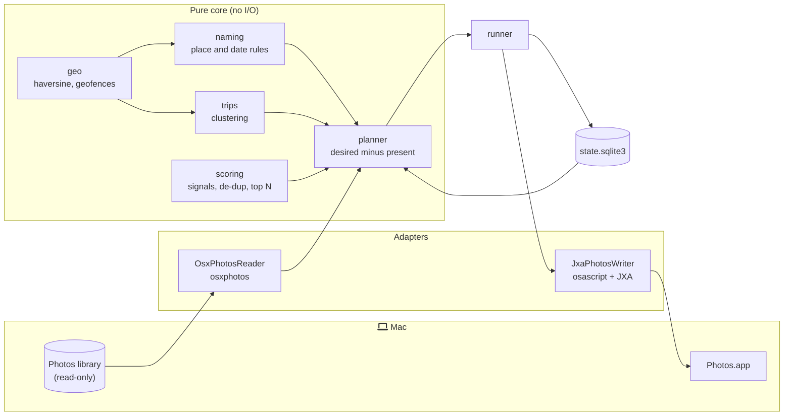

# Architecture

photosorg is a small hexagon. A pure core decides what should happen; two adapters talk to the Mac; a SQLite file remembers what already happened.

## Modules

| Module | Kind | Responsibility |
| --- | --- | --- |
| `models.py` | core | `Photo`, `Membership`, `Trip`, `ScoredPhoto`, `Plan` |
| `config.py` | core | TOML parsing, defaults, validation (unknown keys are errors) |
| `geo.py` | core | Haversine distance, geofence matching |
| `naming.py` | core | Deterministic album names from templates |
| `trips.py` | core | Away-from-home clustering, sticky trip names |
| `scoring.py` | core | Signals, penalties, burst and duplicate handling, top N |
| `planner.py` | core | Desired memberships minus recorded memberships |
| `state.py` | infrastructure | SQLite store for runs, memberships, trips, judged events |
| `runner.py` | orchestration | `run`, `plan`, `undo` over the ports |
| `ports.py` | seam | `PhotoReader` and `PhotoWriter` protocols |
| `adapters/osxphotos_reader.py` | adapter | Maps osxphotos `PhotoInfo` to `Photo` |
| `adapters/jxa_writer.py` + `jxa/photos_album.js` | adapter | Album membership and keywords through Photos scripting |
| `adapters/memory.py` | adapter | In-memory reader and writer for tests and `--demo` |
| `launchd.py` | infrastructure | LaunchAgent plist rendering, `plutil -lint`, `launchctl` |
| `cli.py`, `report.py` | interface | Commands and deterministic text output |

## Desired state, not events

Each run computes the full set of memberships the photos in its window should have, then subtracts what the state DB says is already there. Only the difference is written. This is the same idea as a Terraform plan, and it gives three properties for free.

1. Idempotency. A second run over the same photos adds nothing and calls Photos zero times.
2. Late metadata is picked up. A photo that synced before Photos finished reverse geocoding gets its country and city albums on a later run, as long as it is inside the lookback window.
3. Undo is exact. Every membership row carries the run id that created it.

The window for `--since auto` is the last good run's high-water mark minus `trips.lookback_days`. The reader compares that against both the capture date and the date the photo was added, so a photo taken offline last week and synced today is still new.

## What is judged once

Album membership is recomputed every run. Favourite suggestions are not. A day (or a trip, with `group_by = "event"`) is judged once, after it is over plus `settle_hours`, and recorded in `suggested_events`. A stronger photo that syncs late for an already judged day is filed into its albums but does not reshuffle the suggestions. This keeps the "Suggested favourites" album stable instead of churning under you.

## Trips are sticky

When a trip is first detected it gets a name like `Trip · Paris · 2026-05` and is stored with its start and end dates. Later clusters that touch it (overlap, or within `max_gap_days`) join that trip under the same name, even if a later day shifts which city has the most photos. A new trip that would collide with an existing name gets ` (2)`.

## Failure model

Each album is written, then recorded, in chunks of 200. If Photos quits halfway, the run is marked `failed`, every addition that did land is recorded under its run id, and the high-water mark does not move. The next run retries what is missing; `photosorg undo --run <id>` reverts what landed.
